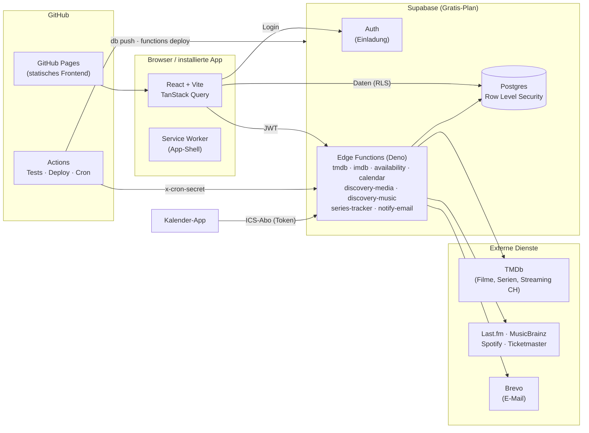

# Watchlist-App

Filme, Serien und Musik entdecken – für mich und meine Freunde. Eine private Web-App (installierbar auf dem Handy), die eine einfache Watchlist zu einer persönlichen Entdeckungs-Zentrale macht.

**App:** <https://mariosch08.github.io/Watchlist-App/> · **Einrichtung:** [`docs/SETUP.md`](docs/SETUP.md) · **Stand:** [`PROGRESS.md`](PROGRESS.md) · **Entscheidungen:** [`DECISIONS.md`](DECISIONS.md) · **Design:** [`docs/DESIGN.md`](docs/DESIGN.md)

## Was die App kann

| Bereich | Funktionen |
| --- | --- |
| **Watchlist** | Suche (Deutsch und Originaltitel), Status, Bewertung 1–10, Filter, Sortierung, Rückgängig |
| **Detailseite** | Trailer (lädt erst nach Klick), Besetzung, ähnliche Titel, Streaming in der Schweiz, Soundtrack-Link, „Gesehen am …“ |
| **Serien** | Folgen abhaken, „Als Nächstes“, Spoiler-Schutz, neue Staffeln/Folgen als Benachrichtigung, Kalender-Abo (ICS) |
| **Für dich** | Tägliche Vorschläge mit Begründung, 👍/👎 lernt mit, Genre-Regler, „Was schauen wir heute?“ |
| **Streaming** | Welches Abo lohnt sich? Kaum genutzte Dienste, beste Zweier-Kombination, Alarm „jetzt auf meinen Diensten“ |
| **Musik** | Neue Alben der Lieblings-Artists und ähnlicher Bands (Last.fm, MusicBrainz, optional Spotify), Konzerte in der Schweiz |
| **Freunde** | Freundschaften, Geschmacks-Match in %, „Wer hat es gesehen?“, „Schau das!“, Aktivität (freiwillig) |
| **Listen & Sammlungen** | Private Sammlungen oder gemeinsame Listen mit Rollen, Abstimmen, Swipen bis zum Match, Filmabend-Planer mit Terminumfrage |
| **Tagebuch & Statistik** | Wann, wo, mit wem; Jahresstatistik, teilbarer Jahresrückblick, Herausforderungen |
| **Import/Export** | IMDb, Letterboxd, Trakt; IMDb-CSV- und JSON-Export, Konto löschen |
| **Benachrichtigungen** | In der App, Sofort-Mails und Wochenrückblick (Brevo), Abmelden mit einem Klick |
| **App** | Installierbar (PWA), offline startbar, „Teilen → Watchlist“ aus anderen Apps |

## Architektur



**Sicherheitsprinzipien**

- Jede Tabelle hat Row Level Security; die User-ID kommt immer aus dem Token, nie aus dem Request.
- Spalten-Grants begrenzen, was der Client ändern darf.
- Fremde Profile (mit E-Mail) sind nie direkt lesbar. Namen von Freunden liefern nur geprüfte Funktionen.
- Spotify-Tokens liegen AES-GCM-verschlüsselt in der Datenbank und sind für den Client gesperrt.
- Secrets gehören nur in GitHub- bzw. Supabase-Secrets.
- Strenge Rechte-Tests decken das alles ab (`tests/*.test.js`).

## Entwickeln

```bash
npm install && npm test                      # DB-Tests (PGlite) und Logik der Edge Functions
cd frontend && npm install && npm test       # Frontend-Tests (Vitest, Testing Library)
npm run lint && npm run dev                  # http://localhost:5173 (braucht .env mit VITE_SUPABASE_URL/ANON_KEY)
cd supabase/functions && deno check */index.ts
```

| Ordner | Inhalt |
| --- | --- |
| `frontend/` | React-App (Seiten, Komponenten, `lib/` mit reiner, getesteter Logik) |
| `supabase/migrations/` | Datenmodell, RLS, Funktionen – wird beim Merge nach `main` automatisch eingespielt |
| `supabase/functions/` | Edge Functions; `_shared/` enthält reine TS-Module, die auch das Frontend importiert |
| `tests/` | Datenbank- und Funktionstests (externe APIs gemockt) |
| `.github/workflows/` | `deploy.yml` (Tests → Supabase → Pages), `cron.yml` (tägliche Jobs, Mails) |

## Datenquellen

Film- und Seriendaten von [TMDb](https://www.themoviedb.org) (diese App nutzt die TMDb-API, ist aber nicht von TMDb unterstützt oder zertifiziert); Streaming-Angebote von JustWatch über TMDb. Musik von Last.fm, MusicBrainz und optional Spotify, Konzerte von Ticketmaster.
